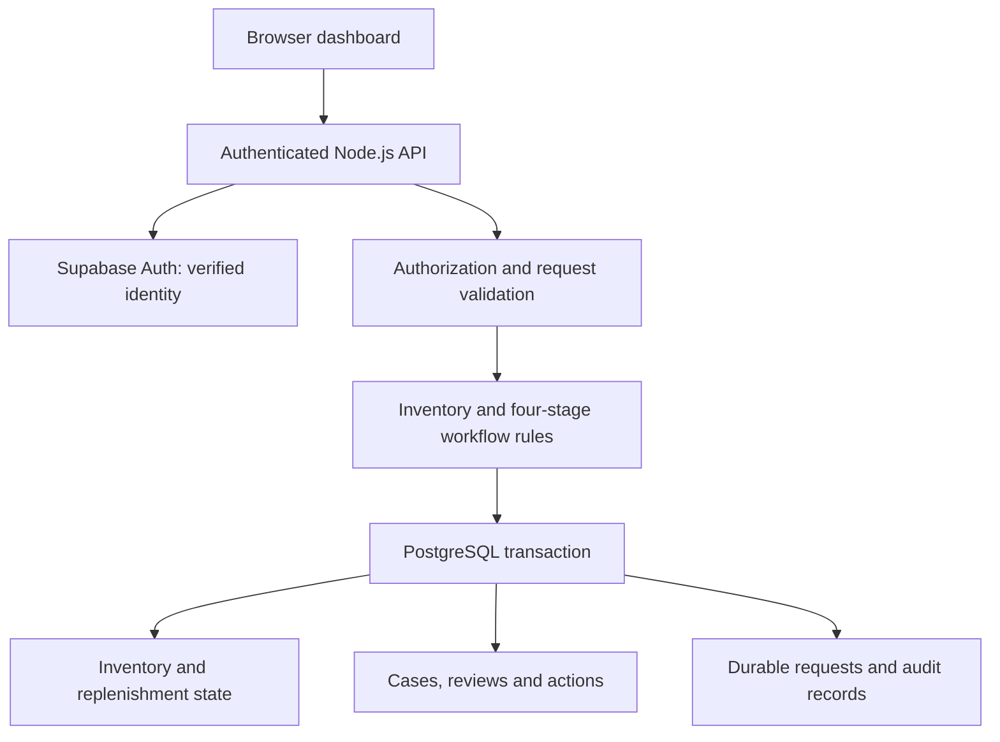

# Lookout

### Inventory you can explain. Decisions you can trace.

**Lookout brings inventory visibility, replenishment tasks, and reviewed stock corrections into one operational workflow.** It is built for the people responsible for keeping goods available, work moving, and inventory records trustworthy: warehouse supervisors, operations managers, inventory controllers, and the teams working alongside them.

A number on a dashboard becomes useful when a team understands what it represents, what changed, and who is responsible for the next decision. Lookout connects those pieces.

**Record stock → coordinate replenishment → investigate a discrepancy → review the evidence → apply an accountable correction.**

Created by **Elliot and Huma**, Lookout combines practical operational workflows with software engineering that treats permissions, consistency, and traceability as part of the product.

---

## Why this market matters

Logistics connects purchasing decisions to physical outcomes. Goods have to arrive, be located, remain available, and move through the right hands before a customer receives what was promised. Inventory accuracy supports each of those steps.

The importance extends beyond large distribution networks. A growing warehouse, regional distributor, retail operation, or stockroom can face demanding coordination problems with a small team. An unexplained discrepancy can mean another physical count, a delayed replenishment, an uncertain handover, or a decision made against an outdated record.

The [U.S. Bureau of Transportation Statistics tracks the movement of goods](https://data.bts.gov/stories/s/bcyt-rqmu) as a central part of the transportation economy. The [World Bank's Logistics Performance Indicators](https://lpi.worldbank.org/en/home) measure supply-chain connectivity, speed, and reliability. Lookout focuses on the operational detail within that wider picture: whether people can trust the inventory information they use to decide what happens next.

For a small or medium-sized business, the opportunity is practical. Clear stock records, visible tasks, and accountable decisions can give managers a stronger basis for organizing work. Lookout is designed around those needs; business improvements must ultimately be measured in real operating environments.

## Why we are building Lookout

Our starting point comes from the work we have done ourselves.

**Elliot has worked in transportation and moving operations**, including as a driver's helper with Amazon and as a mover for a moving company. **Huma has worked in supermarkets, around inventory and product scanning.** These experiences bring together two connected perspectives: moving goods through the physical world and keeping track of merchandise inside a business.

We want to connect logistics and transportation with inventory optimization for smaller businesses. Stores and operations teams deserve practical tools for understanding what they have, what is moving, and what needs attention when records and physical stock disagree.

Missing merchandise, damaged products, and uncertain counts are important parts of the problem we want to address. Lookout's current implementation focuses on stock visibility, replenishment, and reviewed count reconciliation; dedicated damage reporting and broader transportation integrations remain future work.

Our aim is to help small businesses compete with clearer information and stronger operational control. The product's priorities reflect that aim:

- **Clarity:** show stock, location, work in progress, and recent changes together.
- **Accountability:** connect evidence, review, decisions, and resulting actions.
- **Control:** require supported decisions before consequential stock corrections.
- **Reliability:** make retries, concurrent requests, and interrupted sessions behave predictably.
- **Practicality:** keep the essential workflow usable without paid AI credits.

## Built around the questions operations teams ask

| Operational question | How Lookout addresses it |
| --- | --- |
| What do we have, and where is it stored? | Inventory records connect an item, its storage location, and its recorded units on hand. |
| What stock has arrived? | Receiving stock increases the recorded quantity and adds an activity entry. |
| Which units are being moved to the shelf? | Starting a replenishment task deducts the selected units from recorded stock and creates a pending task. |
| Were those units replenished or returned? | Explicit task outcomes preserve the deduction or restore the units. |
| Why does a physical count disagree with the record? | A discrepancy case separates reported observations, calculated variance, and unresolved questions. |
| Who authorized a correction? | The authenticated platform records the reviewer's identity, decision, and rationale. |
| Did a retry apply the same change twice? | Durable request records identify repeat requests and return their committed result. |
| Has the stock changed since the case was reviewed? | Revision checks reject stale changes so a correction cannot silently overwrite newer work. |

## The inventory and replenishment workflow

### Record inventory with its operational context

Each inventory item carries a name, a location reference, and a recorded quantity. Locations are reusable records, allowing multiple items to share the same storage area without duplicating its identity.

Receiving additional stock updates the on-hand quantity through a defined operation. Counts must be valid whole numbers, and quantity rules guard against invalid or unsafe totals.

### Track replenishment as work with an outcome

Starting a shelf-restock task records the quantity being moved and deducts it from the source inventory immediately. A pending task preserves the item and location details, the selected quantity, and the before-and-after stock calculation.

The operator then records one of two outcomes:

- **Shelf restocked:** complete the task and retain the deduction.
- **Returned:** complete the task and restore the units to inventory.

A completed task cannot be completed again. Activity records make the movement and its outcome visible after the immediate interaction has finished.

This workflow currently models shelf replenishment. Receiving schedules, carrier dispatch, picking waves, returns processing, and warehouse transfers are separate workflows rather than implied capabilities.

## From discrepancy to accountable action

Lookout's Agent Operations workflow divides reconciliation into four explicit responsibilities. Each stage produces structured information that the next stage can validate.

| Stage | Responsibility | Control |
| --- | --- | --- |
| **1. Event intake** | Capture the reported count, source, time, item reference, and supporting evidence. | Conflicting evidence and invalid event data are rejected. Unknown information stays explicit. |
| **2. Reconciliation** | Compare the observation with recorded inventory and assemble a case. | Facts, inferences, and unknowns remain distinct. A count correction requires supporting evidence. |
| **3. Human review** | Approve, reject, or request more information, with a recorded rationale. | Unsupported corrections cannot be approved. In the authenticated platform, reviewer identity and time come from the server. |
| **4. Inventory action** | Apply an approved correction and record the result. | Current stock is rechecked, repeated actions are controlled, and the approver cannot execute their own approval. |

### An example: eight recorded units, five observed

An operator reports five units against an inventory record showing eight. Lookout records the supporting count evidence and calculates a variance of three units.

The case preserves an important distinction: the count differs, but **the cause of that difference remains unknown**. The system does not turn a discrepancy into an accusation of theft, loss, or employee misconduct.

An authorized reviewer evaluates the case and records a decision. If approved, a different authorized operator can apply the verified count. If stock has changed since reconciliation, the action is rejected for reassessment. A successful correction connects the event, case, evidence, review, action request, and resulting activity record.

The result is a stock correction that someone can inspect and explain.

## A workspace for operators and managers

The dashboard brings together inventory, pending replenishment tasks, recent activity, and discrepancy cases. Operators can see the work in front of them; reviewers can inspect the basis for a correction; managers can follow the sequence of actions that produced the current record.

The authenticated platform supports three application roles:

| Role | Operational responsibilities |
| --- | --- |
| **Worker** | Read workspace records, add and receive stock, manage replenishment tasks, submit observations, reconcile cases, and execute approved actions. |
| **Reviewer** | Read workspace records and approve, reject, or request information on cases. |
| **Administrator** | Perform the supported operational responsibilities and prepare worker or reviewer invitations for new teammates. |

Members intentionally share inventory within their own workspace. A new account without an invitation receives a separate workspace. An invitation prepared before registration binds a new teammate to the intended workspace and role.

Review and execution remain separate even for an administrator. The product preserves that responsibility boundary when an individual has broad permissions.

## How the platform comes together

Lookout uses a small, explicit architecture whose parts correspond to the operational workflow.



### Interface and application rules

The interface uses HTML, CSS, and JavaScript modules. The inventory rules and workflow responsibilities are separate modules, making the business behavior testable independently of the page.

Responsive layouts support narrower screens, with a desktop-and-mobile browser verification gate before a public presentation release. User-entered content is rendered through text-based DOM operations rather than being interpreted as HTML.

### Identity and authorization

The managed identity path uses Supabase email/password authentication. The server validates the provider's returned identity and requires confirmed email before creating a Lookout session. User-editable metadata cannot choose a tenant or grant an application role.

The browser receives an opaque session cookie with production security attributes. The database stores a digest of the session token. Session expiry and current principal permissions are checked during requests; managed sessions are bounded by the provider token lifetime, with an eight-hour maximum.

### Durable PostgreSQL storage

The integrated platform implementation stores inventory alongside relational locations, items, events, cases, reviews, actions, durable request responses, and audit records.

Session-bound row-level security derives workspace access from a live session rather than a caller-selected tenant ID. The inventory connection cannot read principals or call identity/session-issuance functions. A transaction keeps the canonical inventory state and its relational projections consistent. Tenant-qualified references prevent a case, item, review, or action from being accidentally linked to another workspace's records.

The integrated application uses distinct restricted PostgreSQL logins for inventory operations and identity/session issuance. Administrator migration credentials are a separate capability and are never an application fallback. Database connections preserve certificate-chain and hostname verification.

### Correctness under retries and concurrency

Operational software has to handle a repeated click, a lost response, and two people acting at once.

Lookout's database-backed workflow addresses those situations through:

- **Transactions:** related inventory, request, and audit records commit together or roll back together.
- **Revision checks:** an operation based on an older stock revision is rejected.
- **Tenant inventory locking:** concurrent transitions within a workspace are serialized.
- **Durable idempotency:** the same request returns its original committed result; reusing its identifier for different input is rejected.
- **Action constraints:** a reviewed case cannot produce repeated inventory corrections.
- **Audit integrity:** a failed audit write prevents the surrounding stock transaction from partially committing.

The current tenant-level lock favors correctness. Higher throughput, larger workspaces, retention policies, and narrower locking require measurement and further engineering.

## What “agents” means in Lookout

The four agents are deterministic software responsibilities: intake, reconciliation, review coordination, and inventory action. Their contracts are explicit and their results can be tested.

**The core workflow operates without Anthropic API credits or any paid language-model call.** The implemented count-reconciliation path makes no live LLM request.

The design leaves room to evaluate future assistance with evidence summaries or investigation support. Any future model integration must preserve validated inputs, explicit uncertainty, human decision authority, and controlled inventory mutations.

Today's implementation demonstrates reconciliation rules using manually supplied or synthetic observations. Live cameras, sensors, barcode hardware, ERP feeds, and carrier integrations have not been implemented or verified.

## What this demonstrates to an operations business

Lookout connects product decisions to the realities of managing physical work:

| Discipline | Evidence in the product |
| --- | --- |
| **Operational understanding** | Distinct stock, movement, task, evidence, review, and action records. |
| **Product judgment** | A count discrepancy remains an unresolved operational question until evidence and review support a change. |
| **Workflow design** | Explicit ownership, task outcomes, and separation of review from execution. |
| **Backend engineering** | Transactional persistence, durable retries, revision checks, and relational constraints. |
| **Security engineering** | Verified identity, server-controlled permissions, restricted database access, and negative authorization tests. |
| **Delivery discipline** | Branch history, incremental migrations, isolated verification data, and documented release gates. |

The product gives hiring managers a concrete way to evaluate how we approach a business problem: understand the work, model its consequences, build a usable flow, and test the failure paths as carefully as the successful path.

## Verification and current delivery status

The integrated platform has passed 54 unit tests, 19 database/security check groups, 10 local account/session groups, and eight Auth-adapter integration groups using a simulated provider with real PostgreSQL. Migration 005 adds seven dedicated session-bound tenant authorization groups, a real database deployment-adapter check, and a migration-upgrade/idempotence check. Before migration 005, an additional 12 check groups passed against the hosted restricted PostgreSQL runtime account, including concurrency, rollback, tenant isolation, protected-record rejection, persistence across fresh connections, and synthetic-data cleanup.

The original workflow demos, 21 API scenarios, and 20 documented curl checks also pass. Fixture-based Auth tests are distinct from real email-delivery and browser signup/login verification.

**Delivery status:** the integrated implementation brings the original dashboard and four-stage workflow together with authenticated PostgreSQL persistence. Migration 005 and the Vercel adapter are tested locally. Hosted Supabase still has migrations 001–004; applying 005, provisioning the separate identity login, merging the integration branch, and deploying publicly require approval and further verification.

The release work still includes:

- Completing the reviewed integration into `main`.
- Applying the reviewed session-bound tenant mitigation after approval: migration 005 derives inventory RLS context from a valid session and separates identity/session issuance into a distinct restricted login. The identity service and a fully compromised backend remain trusted capabilities; credential separation is not a claim of protection against full process compromise.
- Configuring the exact HTTPS application origin and Supabase confirmation redirects, then testing real signup, email confirmation, login, logout, and persistence in browsers.
- Verifying the Vercel backend entry point, build output, database certificate packaging, and public URL behavior on desktop and mobile.
- Strengthening distributed abuse controls, provider/session revocation synchronization, recovery flows, monitoring, and backup/restore operations before broader production use.

Capacity and operating impact will be evaluated through deployment evidence, feedback from operators, and appropriate load testing.

## Explore the implementation

Use Node.js 24. For the isolated local account experience:

```sh
npm ci
npm run demo:secure
```

Open the loopback address printed in the terminal; the default is `http://127.0.0.1:4173`. This development runner uses real local PostgreSQL and separate development-only authentication. Email ownership is not verified in that mode; use synthetic data and test passwords.

To exercise the application, security boundaries and production assets:

```sh
npm test
npm run test:database
npm run test:accounts
npm run test:supabase
npm run test:tenant-boundary
npm run test:migration-upgrade
npm run test:deployment
npm run build
```

The [deployment readiness guide](docs/deployment-readiness.md) documents production configuration, migration approval, session-bound authorization, restricted database logins, verified TLS and live release checks. `npm start` requires the explicit database and authentication configuration; it has no insecure production fallback.

The [original browser and API walkthrough](docs/agent-operations.md) remains available for the earlier explicit legacy demo. A public presentation must use the authenticated backend, isolated accounts, and synthetic merchandise.

Keep database passwords, session credentials, and private environment files outside version control. The application runtime must never receive the administrator migration connection.

---

**Lookout is built around a simple standard: when inventory changes, the people responsible should be able to explain what happened, why it happened, and who approved the next step.**

See the current [integration and deployment readiness guide](docs/deployment-readiness.md) for session-bound tenant authorization, credential separation, migration 005 approval, and public-release checks.

## Synthetic replenishment reviewer lab

Use `npm run demo:replenishment` for an isolated, clearly labeled supermarket
simulation with realistic fictional stock, low-stock proposals, one-time human
approval, and capped standing policies. No real purchases or external ordering.
See [the walkthrough and boundaries](docs/replenishment-demo.md).
